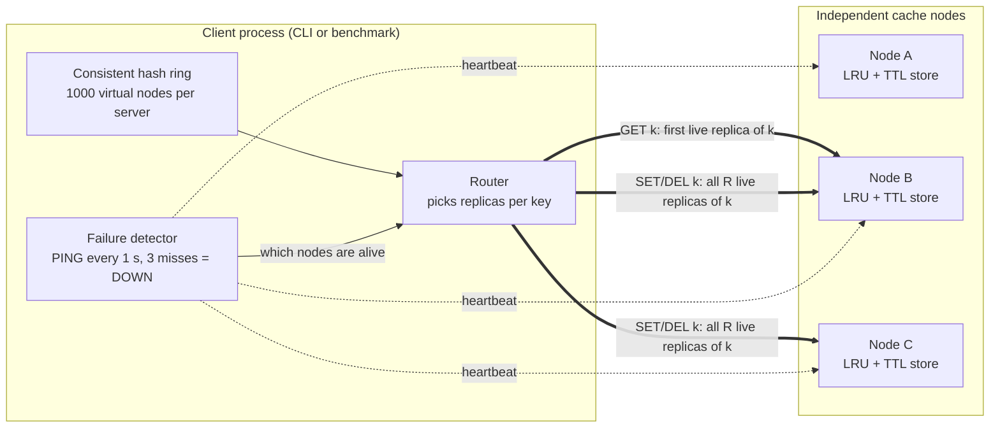

# ShardCache

A distributed in-memory key-value cache written in **C++20**. Keys are
sharded across nodes with a consistent hash ring with virtual nodes, written
synchronously to multiple replicas, and served from a thread-safe LRU cache with
TTL expiry on each node. Heartbeat-based failure detection reroutes traffic around
dead nodes without any leader or coordinator.

**Stack:** C++20 · MSVC · CMake · Winsock (TCP) · GoogleTest · Windows

**Highlights (measured, see [Key results](#key-results)):**

- **55,890 ops/s** with 4 clients on a 3-node cluster; p50 latency **54 µs**, p99 **214 µs**
- Adding a node remapped **24.7%** of keys with consistent hashing, vs **74.9%** with `hash % N`
- After a node crash, requests touching it failed for **3.0–3.9 s** before being rerouted to replicas (replication factor 2)

## Key results

All numbers are from one Windows machine over loopback (127.0.0.1), Release build,
3 nodes, 10,000 keys with 16-byte values, 80% GET / 20% SET, uniformly random keys.
Client and servers share the machine, so the numbers mostly reflect the code plus the
OS network stack, not a real network.

**Throughput and latency** (`shardcache_bench load`, 10 s per run):

| Client threads | Replication | Throughput | p50 | p95 | p99 |
|---|---|---|---|---|---|
| 1 | R=2 | 14,284 ops/s | 54 µs | 146 µs | 235 µs |
| 4 | R=2 | 55,890 ops/s | 54 µs | 134 µs | 214 µs |
| 4 | R=1 | 63,446 ops/s | 50 µs | 96 µs | 179 µs |

- **Scaling:** ~3.9× throughput from 1 to 4 clients with no change in median latency, so
  the per-node lock doesn't appear to be the dominant bottleneck at this tested load
  (heavier contention or many more connections weren't tested).
- **Cost of replication:** R=2 delivers ~12% lower throughput than R=1 in this benchmark.
  Every request makes one round trip, but a write must also be acknowledged by the second
  replica (contacted after the first), so writes (20% of traffic) take a second round
  trip. The latency difference is most visible at p95 and p99.

**Failover** (`shardcache_bench failover`, one node killed mid-run, 3 runs):

- **Failed-request window: 3.0–3.9 s**, measured from the first to the last failed request
  (heartbeat every 1 s, 3 misses to mark a node down). Requests not touching the dead node
  kept succeeding throughout. The last observed failure marks the approximate end of the
  failure window; after it, no further failures occurred before the benchmark ended. The tool warns if a run ends while requests
  are still failing.
- During that window ~40% of requests failed, matching the expected share: reads whose
  first live replica was the dead node, and writes whose replica set included it.
- In the failover integration test, every key whose write was acknowledged before the
  crash was still readable afterwards.

**Consistent hashing** (100,000 keys):

- Adding a 4th node to 3 remapped **24.7%** of keys (ideal: 25%), vs **74.9%** with modulo hashing.
- Load balance across 5 nodes, busiest node as a % of its fair share:

| Virtual nodes per server | 1 | 10 | 100 | 1000 |
|---|---|---|---|---|
| Busiest node | 305% | 150% | 120% | **103%** |

## Architecture



*Example for one key `k` whose live replicas are [B, C]. A different key, or the same key
after B fails, gets a different replica set.*

1. The client-side router hashes the key onto the ring and gets its **preference
   list**: every node, in clockwise order from the key.
2. It keeps the first R live nodes (default R=2). Normally that's the key's primary
   and the next distinct node; if one is down, the next live node takes its place.
3. `GET` goes to the first of them. `SET/DEL` go to all R, and succeed only if all R
   succeed.
4. Each node is an independent TCP server (one thread per connection) holding a
   thread-safe LRU + TTL store. Nodes don't talk to each other.
5. A failure detector thread in the router pings every node; 3 missed heartbeats in
   a row mark a node DOWN, and step 2 skips it from then on.

The router is a library inside each client (the CLI and the benchmark), so every request
is one network hop and there's no central router to fail.

## Key technical decisions

**Consistent hashing with 1000 virtual nodes.** With `hash % N`, adding a node moves
~N/(N+1) of all keys; on the ring, only ~1/(N+1) move. Each server is placed on the ring
1000 times so every node gets an even share (measured above). The ring is a `std::map`
from 64-bit position to node, so "next node clockwise" is one `lower_bound`. It uses a
fixed hash (FNV-1a + a mixing step), not `std::hash`, because every client must agree on
key placement and `std::hash` can differ between compilers.

**LRU cache: hash map + doubly linked list, average O(1).** The list keeps keys in usage
order (most recent at the front); the map points each key to its list node. `get`, `set`
and eviction are average O(1) (an `std::unordered_map` lookup is O(n) in the worst case,
when many keys collide). Each node stores its key so eviction can go from the back of the
list straight to its map entry, without searching.

**Lazy TTL expiry.** Deadlines are checked when a key is read, so there's no background
sweeper and operations stay average O(1). Expired entries are removed when accessed; entries
that stay untouched remain in memory until an eviction removes them, which only happens
when new keys arrive in a full cache. Deadlines use `steady_clock` (the wall clock can jump), and tests inject a fake
clock so TTL tests are instant and deterministic.

**Synchronous replication with a strict guarantee.** Writes go to all R replicas, and
`OK` means the write is on R live nodes. If fewer than R nodes are alive, writes are
rejected rather than stored with fewer copies; reads still work. A failed write returns
`ERROR` without rollback, and retrying is safe because `SET` and `DEL` are idempotent.
I chose this over asynchronous primary-to-replica copying, where an acknowledged write
is lost if the primary dies before forwarding it. The cost is write latency (measured
above). R is capped at the cluster size.

**One lock per store.** Every LRU read moves the key to the front of the list, so reads
also mutate shared state and need exclusive access. A reader-writer lock would therefore
offer little benefit for this design. The lock lives inside the store, so every caller is
safe by default. Lock striping would be the next step if benchmarks showed significant
contention.

**Heartbeats tuned against false positives.** A 1 s interval with 3 misses means a short
pause doesn't mark a healthy node dead, which matters because DOWN nodes don't rejoin.
Heartbeats use their own connections and bounded (non-blocking) connects: on Windows a
refused connection takes ~2 s to fail, which originally made detection take 6.6 s
instead of ~3 s.

**Thread per connection.** Clients are few and long-lived, so this is simple and
sufficient. At thousands of connections, an event loop (IOCP on Windows, epoll on Linux)
would be the next step.

## Quick start

Requires Windows, the MSVC C++ compiler (Visual Studio or its Build Tools, C++20) and
CMake 3.20+ on your PATH (for example, run from a Developer PowerShell for Visual
Studio). The commands assume CMake's default Visual Studio generator, which puts
executables in `build\Release\` and `build\Debug\`. GoogleTest is downloaded
automatically on the first configure.

```powershell
# Build
cmake -S . -B build
cmake --build build --config Release

# Start a 3-node cluster (each node opens in its own window)
powershell -ExecutionPolicy Bypass -File scripts\start_cluster.ps1 -Config Release

# Connect the interactive client to all three nodes
.\build\Release\shardcache_cli.exe 127.0.0.1:7001 127.0.0.1:7002 127.0.0.1:7003

# Benchmarks
.\build\Release\shardcache_bench.exe load --nodes 127.0.0.1:7001,127.0.0.1:7002,127.0.0.1:7003 --threads 4
.\build\Release\shardcache_bench.exe failover --nodes 127.0.0.1:7001,127.0.0.1:7002,127.0.0.1:7003

# Stop every node
powershell -ExecutionPolicy Bypass -File scripts\stop_cluster.ps1
```

## Example usage

The client shows the live replicas for each key in brackets; reads use the first one.

```text
connected to 3 node(s)
> SET user:42 alice
[ 127.0.0.1:7002 127.0.0.1:7003 ] OK
> GET user:42
[ 127.0.0.1:7002 127.0.0.1:7003 ] VALUE alice
> SET session:7 abc123 30
[ 127.0.0.1:7001 127.0.0.1:7002 ] OK
> DEL user:42
[ 127.0.0.1:7002 127.0.0.1:7003 ] DELETED
> GET user:42
[ 127.0.0.1:7002 127.0.0.1:7003 ] NOT_FOUND
> SET cart:9 3_items
[ 127.0.0.1:7003 127.0.0.1:7002 ] OK
```

After closing node 7003's window and waiting ~3 s for it to be marked DOWN, `cart:9` is
read from its replica, and its live replica set moves on to the next node clockwise:

```text
> GET cart:9
[ 127.0.0.1:7002 127.0.0.1:7001 ] VALUE 3_items
```

**Protocol** (one command per line):

| Request | Response |
|---|---|
| `SET <key> <value> [ttl_seconds]` | `OK` |
| `GET <key>` | `VALUE <value>` or `NOT_FOUND` |
| `DEL <key>` | `DELETED` or `NOT_FOUND` |
| `PING` | `PONG` |
| anything invalid | `ERROR <reason>` |

## Testing

83 GoogleTest tests:

```powershell
cmake --build build --config Debug
ctest --test-dir build -C Debug --output-on-failure
```

- **Unit:** LRU eviction order, TTL boundaries (fake clock), protocol parsing, line-length
  limits, hash ring placement and replica selection, percentile math.
- **Concurrency:** 8 threads hammering one store. MSVC has no ThreadSanitizer, so stress
  tests plus a documented locking design stand in for it.
- **Integration:** real TCP servers in-process, covering framing (split and batched
  commands), routing, replication, and failover with injected node failures, including
  writes rejected when fewer than R replicas are alive.
- **Measurement:** key distribution across virtual-node counts, and keys remapped vs modulo.

## Limitations and trade-offs

- **3–4 s of failed requests** after a crash, before the node is marked DOWN. Faster
  detection is a config change, at the cost of more false positives.
- **No rejoin:** a node marked DOWN stays out until the router restarts, because a node
  returning with old data could serve stale values. Safe rejoin needs a data resync.
- **Writes need R live nodes:** with R=2, losing 2 of 3 nodes blocks writes (reads continue).
- **Static membership:** every client must be started with the same node list.
- **No consensus or conflict resolution:** concurrent writes to the same key, or a
  network partition, can leave replicas with different values. Replicas also evict and
  expire independently. For a cache, the worst case is a miss or a stale read.
- Keys and values can't contain spaces (simple line-based protocol), and servers listen
  on 127.0.0.1 only.

## Project structure

```
src/cache/      Store: LRU + TTL, thread-safe
src/net/        Winsock wrapper (RAII sockets) and line framing
src/protocol/   Text protocol parser
src/server/     TCP server and command execution
src/ring/       Consistent hash ring and hash function
src/router/     Client-side router, replication and failure detector
src/bench/      Benchmark statistics
scripts/        Start and stop a local cluster
tests/          GoogleTest suites
```

## Future improvements

- **Node rejoin with resync:** let a recovered node copy current data from its replicas
  before serving again.
- **Event-loop networking** (IOCP / epoll) to handle thousands of connections.
- **Lock striping** inside each node, if benchmarks under heavier load show contention.
- **Length-prefixed values** so keys and values can contain any bytes.
- **Dynamic membership** (a config service or gossip) instead of a static node list.
